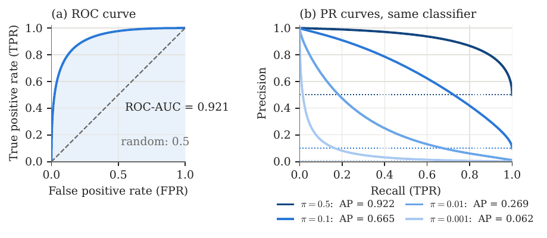
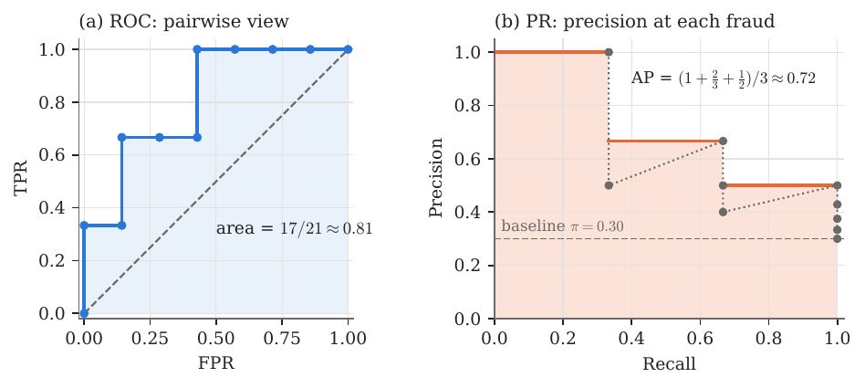
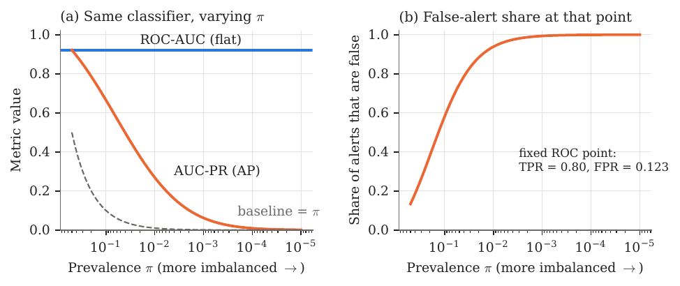
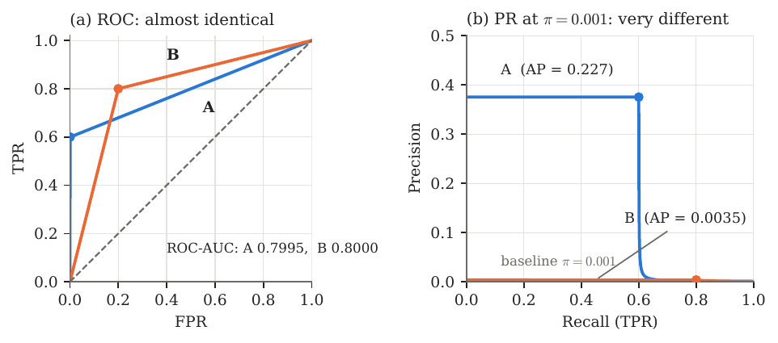

# Classification basics

## Setup and notation

We consider binary classification with a label $Y\in\{0,1\}$, where $1$ is the *positive* class (e.g. a fraudulent transaction) and $0$ the *negative* class. A model produces a real-valued *score* $S=s(X)$, higher meaning “more likely positive”. A threshold $t$ turns the score into a decision 

$$\hat Y_t \;=\; \mathbf 1\{S>t\}.$$

 Let $P$ and $N$ be the numbers of positive and negative cases and $n=P+N$. Two quantities describe how imbalanced the data are: 

$$\pi \;=\; \frac{P}{n}\quad\text{(prevalence)},
  \qquad
  k \;=\; \frac{N}{P} \;=\; \frac{1-\pi}{\pi}\quad\text{(class ratio: negatives per positive)}.$$

   For a fraud rate of $0.1\%$ we have $\pi=0.001$ and $k=999$. Finally, $S^{+}$ and $S^{-}$ denote the score of a randomly drawn positive and negative case respectively; their distributions are the *class-conditional score distributions*.

## The confusion matrix

Fixing a threshold $t$, every case falls into exactly one cell:

|                             | Predicted positive  | Predicted negative  |
|:----------------------------|:-------------------:|:-------------------:|
| Actual positive ($P$ cases) | TP (true positive)  | FN (false negative) |
| Actual negative ($N$ cases) | FP (false positive) | TN (true negative)  |

so that $\mathrm{TP}+\mathrm{FN}=P$ and $\mathrm{FP}+\mathrm{TN}=N$. Everything below is a function of these four counts.

## Rates conditioned on the true class

The first four metrics divide by a *row total* of the confusion matrix. Each is therefore a conditional probability given the true class, which is why none of them depends on $\pi$.

!!! info "True positive rate (TPR)"
    Also known as **recall**, **sensitivity**, **hit rate**, detection rate, or **power** ($=1-$ Type II error rate). It is the probability or proportion of actual positive cases that are correctly flagged as positive. 

    $$\mathop{\mathrm{TPR}}\;=\; \mathop{\mathrm{Rec}}\;=\; \frac{\mathrm{TP}}{\mathrm{TP}+\mathrm{FN}} \;=\; \frac{\mathrm{TP}}{P}
      \;=\; \mathbb{P}(\hat Y_t=1\mid Y=1) \;=\; \mathbb{P}(S^{+}>t).$$

!!! info "False negative rate (FNR)"
    Also known as the **miss rate** or **Type II error rate**. It is the proportion of actual positive cases that are missed. 

    $$\mathop{\mathrm{FNR}}\;=\; \frac{\mathrm{FN}}{\mathrm{FN}+\mathrm{TP}} \;=\; 1-\mathop{\mathrm{TPR}}\;=\; \mathbb{P}(S^{+}\le t).$$

!!! info "False positive rate (FPR)"
    The false positive rate (FPR)—also known as **fall-out**, **false alarm rate**, or **Type I error rate**—is the probability or proportion of actual negative cases that are incorrectly flagged as positive. 

    $$\mathop{\mathrm{FPR}}\;=\; \frac{\mathrm{FP}}{\mathrm{FP}+\mathrm{TN}} \;=\; \frac{\mathrm{FP}}{N}
      \;=\; \mathbb{P}(\hat Y_t=1\mid Y=0) \;=\; \mathbb{P}(S^{-}>t).$$

!!! info "True negative rate (TNR)"
    Also known as **specificity** or **selectivity**. It is the proportion of actual negative cases correctly left unflagged. 

    $$\mathop{\mathrm{TNR}}\;=\; \frac{\mathrm{TN}}{\mathrm{TN}+\mathrm{FP}} \;=\; 1-\mathop{\mathrm{FPR}}\;=\; \mathbb{P}(S^{-}\le t).$$

## Rates conditioned on the prediction

The next three metrics divide by a *column total*: they answer “given that the model said positive (negative), how often is it right?”. They mix the two classes in the proportion $P:N$, so they *do* depend on $\pi$.

!!! info "Precision (positive predictive value, PPV)"
    The proportion of flagged cases that are truly positive. Its complement is the **false discovery rate**, $\mathrm{FDR}=1-\mathop{\mathrm{Prec}}$: the share of alerts that are false alarms. 

    $$\mathop{\mathrm{Prec}}\;=\; \frac{\mathrm{TP}}{\mathrm{TP}+\mathrm{FP}} \;=\; \mathbb{P}(Y=1\mid \hat Y_t=1).$$

!!! info "Negative predictive value (NPV)"
    The proportion of unflagged cases that are truly negative. 

    $$\mathrm{NPV} \;=\; \frac{\mathrm{TN}}{\mathrm{TN}+\mathrm{FN}} \;=\; \mathbb{P}(Y=0\mid \hat Y_t=0).$$

## Single-number summaries at one threshold

!!! info "Accuracy and balanced accuracy"
    $$\mathrm{Acc} \;=\; \frac{\mathrm{TP}+\mathrm{TN}}{n} \;=\; \pi\,\mathop{\mathrm{TPR}}+ (1-\pi)\,\mathop{\mathrm{TNR}},
      \qquad
      \mathrm{BalAcc} \;=\; \tfrac12(\mathop{\mathrm{TPR}}+\mathop{\mathrm{TNR}}).$$

       Accuracy weights the two classes by their frequency, so under heavy imbalance it is dominated by the majority class (the *accuracy paradox*: with $\pi=0.001$, a model that never flags anything has $\mathrm{Acc}=99.9\%$ and $\mathop{\mathrm{TPR}}=0$). Balanced accuracy removes the dependence on $\pi$ by weighting both classes equally.

!!! info "$F_1$ and $F_\beta$ scores"
    $F_1$ is the **harmonic mean** of precision and recall at a single threshold: 

    $$F_{1}\;=\; \frac{2\,\mathop{\mathrm{Prec}}\cdot\mathop{\mathrm{Rec}}}{\mathop{\mathrm{Prec}}+\mathop{\mathrm{Rec}}} \;=\; \frac{2\,\mathrm{TP}}{2\,\mathrm{TP}+\mathrm{FP}+\mathrm{FN}}.$$

     The harmonic mean punishes imbalance between the two: $\mathop{\mathrm{Prec}}=1$ with $\mathop{\mathrm{Rec}}=0.01$ gives $F_{1}\approx0.02$, not $0.5$. The general form $F_\beta=\dfrac{(1+\beta^2)\,\mathop{\mathrm{Prec}}\cdot\mathop{\mathrm{Rec}}}{\beta^2\,\mathop{\mathrm{Prec}}+\mathop{\mathrm{Rec}}}$ treats recall as $\beta$ times as important as precision, so $\beta>1$ favours recall. Like precision, $F_\beta$ ignores true negatives.

!!! info "Matthews correlation coefficient (MCC)"
    The correlation between prediction and truth, using all four cells: 

    $$\mathrm{MCC} \;=\; \frac{\mathrm{TP}\cdot\mathrm{TN}-\mathrm{FP}\cdot\mathrm{FN}}
      {\sqrt{(\mathrm{TP}+\mathrm{FP})(\mathrm{TP}+\mathrm{FN})(\mathrm{TN}+\mathrm{FP})(\mathrm{TN}+\mathrm{FN})}}\in[-1,1].$$

## The bridge identity: how $\pi$ enters

The two families above are linked by the class ratio $k=N/P$. This is the single most important identity in these notes.

!!! success "Proposition 1: Prevalence enters through $k$"
    For every threshold $t$, 

    $$\mathop{\mathrm{Prec}}\;=\; \frac{\mathop{\mathrm{TPR}}}{\mathop{\mathrm{TPR}}+ k\,\mathop{\mathrm{FPR}}},
      \qquad
      F_{1}\;=\; \frac{2\,\mathop{\mathrm{TPR}}}{1+\mathop{\mathrm{TPR}}+k\,\mathop{\mathrm{FPR}}},
      \qquad
      \mathrm{Acc} \;=\; \pi\,\mathop{\mathrm{TPR}}+(1-\pi)(1-\mathop{\mathrm{FPR}}).$$

??? note "Proof"
    *Proof.* By definition $\mathrm{TP}=P\cdot\mathop{\mathrm{TPR}}$ and $\mathrm{FP}=N\cdot\mathop{\mathrm{FPR}}$. Hence 

    $$\mathop{\mathrm{Prec}}=\frac{P\,\mathop{\mathrm{TPR}}}{P\,\mathop{\mathrm{TPR}}+N\,\mathop{\mathrm{FPR}}}=\frac{\mathop{\mathrm{TPR}}}{\mathop{\mathrm{TPR}}+k\,\mathop{\mathrm{FPR}}}.$$

     For $F_1$, note $2\mathrm{TP}+\mathrm{FP}+\mathrm{FN} = 2P\,\mathop{\mathrm{TPR}}+N\,\mathop{\mathrm{FPR}}+P(1-\mathop{\mathrm{TPR}})=P(1+\mathop{\mathrm{TPR}}+k\,\mathop{\mathrm{FPR}})$, so $F_{1}= 2P\,\mathop{\mathrm{TPR}}/\big(P(1+\mathop{\mathrm{TPR}}+k\,\mathop{\mathrm{FPR}})\big)$. The accuracy formula was shown above. ◻

Read this identity slowly: $\mathop{\mathrm{TPR}}$ and $\mathop{\mathrm{FPR}}$ are properties of the classifier alone (they are conditional on the class), while $k$ is a property of the dataset. Whenever $k$ is large, even a tiny $\mathop{\mathrm{FPR}}$ is multiplied by a huge number inside the denominator of precision.

| Metric            | Conditions on | Uses TN? | Depends on $\pi$? |
|:------------------|:-------------:|:--------:|:-----------------:|
| TPR (recall), FNR |  true class   |    no    |        no         |
| FPR, TNR          |  true class   |   yes    |        no         |
| Precision, FDR    |  prediction   |    no    |      **yes**      |
| NPV               |  prediction   |   yes    |        yes        |
| Accuracy          |     both      |   yes    |        yes        |
| Balanced accuracy |  true class   |   yes    |        no         |
| $F_1$, $F_\beta$  |     both      |    no    |      **yes**      |

: Which metrics depend on the class balance.

# Threshold-free summaries: ROC-AUC and AUC-PR

All the metrics so far describe one threshold $t$. As $t$ sweeps from $+\infty$ down to $-\infty$, the classifier flags more and more cases and $(\mathop{\mathrm{FPR}},\mathop{\mathrm{TPR}})$ moves from $(0,0)$ to $(1,1)$. Tracing this path under two different choices of axes gives the two curves.

## The ROC curve and ROC-AUC

!!! abstract "Definition 2: ROC curve"
    The *receiver operating characteristic* curve is the set of points $\big(\mathop{\mathrm{FPR}}(t),\mathop{\mathrm{TPR}}(t)\big)$ over all thresholds $t$.

A random classifier traces the diagonal $\mathop{\mathrm{TPR}}=\mathop{\mathrm{FPR}}$; a perfect one passes through the corner $(0,1)$. The curve is unchanged by any strictly increasing transformation of the scores, since only the *ranking* matters.

!!! abstract "Definition 3: ROC-AUC"
    $$\mathop{\mathrm{AUC\text{-}ROC}}\;=\; \int_0^1 \mathop{\mathrm{TPR}}\; d\mathop{\mathrm{FPR}}.$$

!!! success "Theorem 4: Probabilistic interpretation"
    $$\mathop{\mathrm{AUC\text{-}ROC}}\;=\; \mathbb{P}(S^{+}>S^{-}) + \tfrac12\,\mathbb{P}(S^{+}=S^{-}),$$

     the probability that a randomly chosen positive case is scored above a randomly chosen negative case.

??? note "Proof"
    *Proof.* Assume continuous scores with density $f^{-}$ for negatives (ties then have probability zero). Since $\mathop{\mathrm{FPR}}(t)=\mathbb{P}(S^{-}>t)$, we have $d\mathop{\mathrm{FPR}}=-f^{-}(t)\,dt$, and as $t$ runs from $+\infty$ to $-\infty$ the FPR runs from $0$ to $1$. Therefore 

    $$\mathop{\mathrm{AUC\text{-}ROC}}=\int_{-\infty}^{\infty}\mathbb{P}(S^{+}>t)\,f^{-}(t)\,dt=\mathbb{P}(S^{+}>S^{-}).$$

     Ties contribute half by the usual trapezoid convention. ◻

So $\mathop{\mathrm{AUC\text{-}ROC}}=0.5$ means random ranking and $1$ means every positive is ranked above every negative. Note what does *not* appear in this definition: the proportion of positives.

## The precision–recall curve and AUC-PR

!!! abstract "Definition 5: PR curve"
    The *precision–recall* curve is the set of points $\big(\mathop{\mathrm{Rec}}(t),\mathop{\mathrm{Prec}}(t)\big)=\big(\mathop{\mathrm{TPR}}(t),\mathop{\mathrm{Prec}}(t)\big)$ over all thresholds $t$.

A classifier with no skill (scores independent of the label) has $\mathop{\mathrm{Prec}}=\pi$ at every recall level, so the PR curve’s baseline is the horizontal line at the *prevalence*, not at $0.5$. True negatives never appear on either axis.

!!! abstract "Definition 6: AUC-PR / average precision"
    Sort cases by decreasing score and let $\mathop{\mathrm{Prec}}_j,\mathop{\mathrm{Rec}}_j$ be the precision and recall after the $j$-th distinct threshold (with $\mathop{\mathrm{Rec}}_0=0$). The *average precision* is 

    $$\mathop{\mathrm{AP}}\;=\; \sum_{j}\big(\mathop{\mathrm{Rec}}_j-\mathop{\mathrm{Rec}}_{j-1}\big)\,\mathop{\mathrm{Prec}}_j
      \;\xrightarrow{\;\text{continuous limit}\;}\;
      \int_0^1 \mathop{\mathrm{Prec}}\; d\mathop{\mathrm{Rec}}.$$

       Equivalently, $\mathop{\mathrm{AP}}$ is the mean, over the $P$ positive cases, of the precision measured at the rank of that positive.

!!! note "Remark"
    *Remark 1*. “Average precision” is a recall-weighted average (weights $\mathop{\mathrm{Rec}}_j-\mathop{\mathrm{Rec}}_{j-1}$), not a plain average over thresholds. “AUC-PR” is used loosely: computing the area with the trapezoid rule instead of this step sum linearly interpolates between operating points, which is generally over-optimistic, and some benchmarks use an “interpolated” variant. Always state which one you report. The step-wise $\mathop{\mathrm{AP}}$ is what `sklearn.metrics.average_precision_score` computes.

Figure 1 already contains the whole story: one classifier, one ROC curve, but a family of PR curves indexed by $\pi$. Sections 3 and 4 make this precise.

# Worked examples

## A ten-transaction toy example

Rank ten transactions by model score from highest to lowest. Three are fraud (P), seven are legitimate (N), and the true labels in rank order are 

$$\text{P, N, P, N, N, P, N, N, N, N}.$$

 Flagging the top $j$ cases gives the operating points in Table 1.

| $j$ | label | TP  | FP  | TPR (recall) |  FPR  | Precision |     |
|:---:|:-----:|:---:|:---:|:------------:|:-----:|:---------:|:---:|
|  1  |   P   |  1  |  0  |    $1/3$     |  $0$  |    $1$    |     |
|  2  |   N   |  1  |  1  |    $1/3$     | $1/7$ |   $1/2$   |     |
|  3  |   P   |  2  |  1  |    $2/3$     | $1/7$ |   $2/3$   |     |
|  4  |   N   |  2  |  2  |    $2/3$     | $2/7$ |   $1/2$   |     |
|  5  |   N   |  2  |  3  |    $2/3$     | $3/7$ |   $2/5$   |     |
|  6  |   P   |  3  |  3  |     $1$      | $3/7$ |   $1/2$   |     |
|  7  |   N   |  3  |  4  |     $1$      | $4/7$ |   $3/7$   |     |
|  8  |   N   |  3  |  5  |     $1$      | $5/7$ |   $3/8$   |     |
|  9  |   N   |  3  |  6  |     $1$      | $6/7$ |   $1/3$   |     |
| 10  |   N   |  3  |  7  |     $1$      |  $1$  |  $3/10$   |     |

*Operating points when flagging the top $j$ cases ($P=3$, $N=7$).*

**ROC-AUC (pairwise view).** By Theorem 4, count for each fraud how many legitimate cases it outranks: the first fraud beats all $7$, the second beats $6$, the third beats $4$. Hence 

$$\mathop{\mathrm{AUC\text{-}ROC}}=\frac{7+6+4}{3\times7}=\frac{17}{21}\approx0.81 .$$

 **AUC-PR (precision at each fraud).** The precisions at the ranks of the three frauds are $1$, $2/3$ and $1/2$ (the rows with label P in the table), so 

$$\mathop{\mathrm{AP}}=\frac{1+\tfrac23+\tfrac12}{3}=\frac{13}{18}\approx0.72,
  \qquad\text{against a baseline of } \pi=0.30.$$

   Both views are drawn in Figure 2. Here $\pi=0.3$ is not extreme, so the two metrics tell a broadly similar story. The next two examples show what happens when it is.

## One classifier, increasing imbalance

Take the Gaussian score model of Figure 1: negatives score $\mathcal N(0,1)$ and positives $\mathcal N(\mu,1)$ with $\mu=2$. Then $\mathop{\mathrm{AUC\text{-}ROC}}=\Phi(\mu/\sqrt2)\approx0.921$. Keep the classifier *exactly fixed* and change only the prevalence $\pi$, equivalently the number of legitimate cases the model has to sift through.

| Prevalence $\pi$ | $k=N/P$ | ROC-AUC | AUC-PR (AP) | Baseline ($=\pi$) | AP / $\pi$ |
|-----------------:|--------:|:-------:|:-----------:|:-----------------:|:----------:|
|              0.5 |       1 |  0.921  |    0.922    |        0.5        |    1.8     |
|              0.1 |       9 |  0.921  |    0.665    |        0.1        |    6.7     |
|             0.01 |      99 |  0.921  |    0.269    |       0.01        |    26.9    |
|            0.001 |     999 |  0.921  |    0.062    |       0.001       |    61.8    |

*The same classifier at four prevalences (Gaussian model, $\mu=2$; values by numerical integration of $\int \mathop{\mathrm{Prec}}\,d\mathop{\mathrm{Rec}}$).*

!!! success "Proposition 7: Negative inflation, a thought experiment"
    *Replace every negative case by $m$ copies drawn from the same distribution (so $N\to mN$ and $k\to mk$). Then for every threshold $\mathop{\mathrm{TPR}}(t)$ and $\mathop{\mathrm{FPR}}(t)$ are unchanged, so the ROC curve and ROC-AUC are *exactly* unchanged, while $\mathrm{FP}\to m\,\mathrm{FP}$ and $\mathop{\mathrm{Prec}}\to\mathop{\mathrm{TPR}}/(\mathop{\mathrm{TPR}}+mk\,\mathop{\mathrm{FPR}})$, so the PR curve and $\mathop{\mathrm{AP}}$ change.*

??? note "Proof"
    *Proof.* $\mathop{\mathrm{TPR}}$ conditions on positives, which were not touched; $\mathop{\mathrm{FPR}}=\mathbb{P}(S^{-}>t)$ is a probability under the (unchanged) negative score distribution. Precision follows from Proposition 1 with $k$ replaced by $mk$. ◻

Going from $\pi=0.1$ to $\pi=0.01$ in Table 2 is exactly this experiment with $m=11$: the ROC-AUC does not move ($0.921$) while AP drops from $0.665$ to $0.269$.

!!! note "Remark"
    *Remark 2*. These are population values. With a finite sample the estimate is noisy, especially when there are few positives: a simulation with $10^6$ negatives and about $1000$ positives gave $\mathop{\mathrm{AP}}\approx0.057$ against the population value $0.062$, whereas the ROC-AUC estimate ($\approx0.92$) is stable. Report confidence intervals (e.g. by bootstrap) when $P$ is small.

## Two models that ROC-AUC cannot tell apart

Now compare two *different* classifiers on a data set of $10^6$ transactions with $1000$ frauds ($\pi=0.001$, $k=999$). Model A catches $60\%$ of the frauds while flagging only $0.1\%$ of legitimate transactions; Model B catches $80\%$ but flags $20\%$ of legitimate transactions. Interpolating linearly to the corner $(1,1)$ gives the ROC curves in Figure 4(a).

| Model | TPR | FPR | TP | FP | Precision | Alerts |
|:--|:-:|:-:|:-:|:-:|:-:|:-:|
| A | 0.60 | 0.001 | 600 | 999 | 0.375 | 1 599 |
| B | 0.80 | 0.20 | 800 | 199 800 | 0.004 | 200 600 |

An investigation team would obviously prefer A. B finds a third more fraud but buries it under two hundred times as many false alarms. ROC-AUC ranks B (marginally) first; AP ranks A first by a factor of $64$. The analytic reason is the subject of the next section.

## What each metric is trying to accomplish

|  | **ROC-AUC** | **AUC-PR (AP)** |
|:---|:---|:---|
| Question it answers | “If I draw a random fraud and a random legitimate case, how often is the fraud scored higher?” | “As I demand to catch more of the frauds, what fraction of my alerts are real?” |
| Axes | $\mathop{\mathrm{TPR}}$ vs. $\mathop{\mathrm{FPR}}$ | Precision vs. recall |
| Uses true negatives | Yes (through $\mathop{\mathrm{FPR}}$) | No |
| Random baseline | $0.5$ | $\pi$ (prevalence) |
| Depends on $\pi$ | No (Theorem 4) | Yes (through $k$; Section 4) |
| Cost of a false positive | Scaled by $1/N$: ignores how many negatives there are | Scaled by $k$: each false positive hurts more when negatives dominate |
| Where it looks | All FPR levels equally | The high-precision, low-FPR region |
| Best used when | Comparing rankers, or when the class ratio is unknown or will shift | Positives are rare and alerts are costly (fraud, screening, retrieval) |

!!! tip "Heuristic summary"
    ROC-AUC measures *ranking quality in a world where both classes are equally represented*; it is a property of the two score distributions. AUC-PR measures *usefulness of the alert list in the world you will actually deploy in*: it bakes the class ratio into precision. When positives are rare, that second question is the one that determines whether the model is useful, and Proposition 7 shows the first question cannot even see the difference.

# Why AUC-PR is preferred under imbalance: a proof

## Setting

Parametrise the ROC curve by recall. Assume (for simplicity) that the ROC curve is the graph of a continuous, nondecreasing function 

$$g:[0,1]\to[0,1],\qquad g(r)=\mathop{\mathrm{FPR}}\text{ at the threshold where } \mathop{\mathrm{TPR}}=r,\qquad g(0)=0,\; g(1)=1 .$$

 (In general replace $g$ by a generalised inverse; the formulas hold as Stieltjes integrals.) Let $r^{*}=\sup\{r:g(r)=0\}$ be the fraction of positives the model can capture before its first false alarm ($r^{*}=0$ for most real models). The data are described by the pair $(g,k)$: $g$ is a property of the classifier, $k$ of the dataset.

!!! success "Lemma 8: Both areas in terms of $g$"
    $$\mathop{\mathrm{AUC\text{-}ROC}}\;=\; 1-\int_0^1 g(r)\,dr,
      \qquad\qquad
      \mathop{\mathrm{AP}}(k) \;=\; \int_0^1 \frac{r}{\,r+k\,g(r)\,}\,dr .$$

??? note "Proof"
    *Proof.* The unit square is split by the ROC curve into the area under it, which is $\mathop{\mathrm{AUC\text{-}ROC}}$, and the area to its left, which is $\int_0^1 g(r)\,dr$ (integrating FPR against recall). The two add up to $1$. The AP formula is $\int \mathop{\mathrm{Prec}}\,d\mathop{\mathrm{Rec}}$ with $\mathop{\mathrm{Prec}}=r/(r+k\,g(r))$ from Proposition 1. ◻

Lemma 8 is the whole argument in one line: **$k$ appears in AP and nowhere in ROC-AUC.**

## ROC-AUC is blind to imbalance; AP is not

!!! success "Theorem 9: Behaviour of AP in $k$"
    *For a fixed classifier (fixed $g$):*
    
    1.  ***Monotonicity.** $\mathop{\mathrm{AP}}(k)$ is nonincreasing in $k$, and strictly decreasing whenever $g$ is not identically $0$. Indeed $\displaystyle \frac{\partial}{\partial k}\frac{r}{r+k\,g(r)}=-\frac{r\,g(r)}{(r+k\,g(r))^{2}}\le0 .$*
    
    2.  ***Baseline.** For a no-skill classifier, $g(r)=r$, so $\mathop{\mathrm{AP}}=\int_0^1\frac{dr}{1+k}=\frac1{1+k}=\pi$.*
    
    3.  ***Collapse.** $\displaystyle\lim_{k\to\infty}\mathop{\mathrm{AP}}(k)=r^{*}$. In particular $\mathop{\mathrm{AP}}\to0$ whenever the model cannot reach positive recall with zero false positives.*
    
    4.  ***ROC-AUC is constant.** $\mathop{\mathrm{AUC\text{-}ROC}}$ does not depend on $k$ (Lemma 8).*

??? note "Proof"
    *Proof.* (a) is the derivative computation, integrated over $r$. (b) is direct substitution. For (c), the integrand $r/(r+k\,g(r))$ is bounded by $1$ and, as $k\to\infty$, converges pointwise to $1$ on $(0,r^{*})$ where $g=0$, and to $0$ on $(r^{*},1]$ where $g>0$ and $r>0$. By dominated convergence $\mathop{\mathrm{AP}}(k)\to r^{*}$. (d) is Lemma 8. ◻

So the same classifier has ROC-AUC fixed and AP sliding from near $1$ (balanced) down to $r^{*}$, which is usually $0$, as the data become more imbalanced, exactly as in Table 2. AP is therefore *sensitive* to the quantity (the class ratio) that determines the real-world cost of false alarms, while ROC-AUC is not.

## The two metrics look at different parts of the ROC curve

Theorem 9 shows AP varies with $k$ but does not yet explain why that is the right behaviour, nor how ROC-AUC could rank two models wrongly. The next result localises where each metric gets its value.

!!! success "Theorem 10: Complementary regions"
    *Fix $\alpha\in(0,1)$.*
    
    1.  ***ROC-AUC barely sees low FPR.** The part of ROC-AUC contributed by $\mathop{\mathrm{FPR}}\le\alpha$ is $\int_{0}^{\alpha}\mathop{\mathrm{TPR}}\,d\mathop{\mathrm{FPR}}\le\alpha$.*
    
    2.  ***High precision lives at low FPR.** If $\mathop{\mathrm{Prec}}\ge p$ at recall $r$, then $g(r)\le \dfrac{(1-p)\,r}{p\,k}\le\dfrac{1-p}{p\,k}$. In particular $\mathop{\mathrm{Prec}}\ge\tfrac12$ forces $\mathop{\mathrm{FPR}}\le 1/k$.*
    
    3.  ***AP barely sees high FPR.** The part of AP contributed by recall levels with $g(r)\ge\alpha$ is at most $\dfrac{1}{1+k\alpha}$.*

??? note "Proof"
    *Proof.* (i) $\mathop{\mathrm{TPR}}\le1$, so $\int_0^\alpha \mathop{\mathrm{TPR}}\,d\mathop{\mathrm{FPR}}\le\int_0^\alpha d\mathop{\mathrm{FPR}}=\alpha$.
    
    \(ii\) $\mathop{\mathrm{Prec}}=r/(r+k\,g)\ge p$ rearranges to $g\le r(1-p)/(pk)$, and $r\le1$.
    
    \(iii\) If $g(r)\ge\alpha$ then $\dfrac{r}{r+k\,g(r)}\le\dfrac{r}{r+k\alpha}\le\dfrac{1}{1+k\alpha}$, because $r\mapsto r/(r+c)$ is increasing and $r\le1$. The set of such $r$ has measure at most $1$. ◻

!!! success "Corollary 11: Disjoint supports under imbalance"
    Let $c>0$ and $\alpha=c/k$. Then 

    $$\underbrace{\text{ROC-AUC mass from } \mathop{\mathrm{FPR}}\le c/k}_{\le\; c/k}
      \qquad\text{while}\qquad
      \underbrace{\text{AP mass from } \mathop{\mathrm{FPR}}\ge c/k}_{\le\; 1/(1+c)} .$$

       For $\pi=0.001$ ($k=999$) and $c=9$: the region $\mathop{\mathrm{FPR}}\le0.9\%$ contributes at most $0.9\%$ of the area to ROC-AUC, yet it carries all but at most $0.1$ of the value of AP.

In words: when $k$ is large, ROC-AUC is decided almost entirely by the part of the curve at $\mathop{\mathrm{FPR}}>c/k$, where precision is already poor, and AP is decided almost entirely by the part at $\mathop{\mathrm{FPR}}\le c/k$, which ROC-AUC essentially ignores. Only the second region is operationally affordable, since an alert budget of $B$ false alarms means $\mathop{\mathrm{FPR}}\approx B/N=B/(kP)$.

## Ranking reversal: ROC-AUC can pick the wrong model

Return to Models A and B of Section 3.3, with ROC curves through $(\mathop{\mathrm{FPR}},\mathop{\mathrm{TPR}})=(a,\rho)$ and linear interpolation to $(1,1)$ ($a=0.001,\rho=0.6$ for A; $a=0.2,\rho=0.8$ for B), and $k=999$.

**ROC-AUC.** By the trapezoid rule, $\mathop{\mathrm{AUC\text{-}ROC}}=\tfrac12 a\rho+\tfrac12(1-a)(1+\rho)$: 

$$\mathop{\mathrm{AUC\text{-}ROC}}_A=0.0003+0.7992=0.7995,\qquad
  \mathop{\mathrm{AUC\text{-}ROC}}_B=0.08+0.72=0.8000 .$$

   **AP.** On the first segment $g(r)=ar/\rho$, so the integrand is the constant $1/(1+ka/\rho)$ and the segment contributes 

  $$\rho\cdot\frac{1}{1+ka/\rho}=\frac{\rho^{2}}{\rho+ka}:\qquad
  A:\ \frac{0.36}{0.6+0.999}=0.2251,\qquad
  B:\ \frac{0.64}{0.8+199.8}=0.0032 .$$

   The second segment (from $\rho$ to $1$) adds $0.0017$ for A and $0.0004$ for B by numerical integration, so 

  $$\mathop{\mathrm{AP}}_A\approx0.227,\qquad \mathop{\mathrm{AP}}_B\approx0.0035,\qquad \frac{\mathop{\mathrm{AP}}_A}{\mathop{\mathrm{AP}}_B}\approx64 .$$

**Why this is not a coincidence.** Model A’s entire advantage over B lies in $\mathop{\mathrm{FPR}}\in[0,0.001]$. By Theorem 10(i) that slice can contribute at most $0.001$ to ROC-AUC (it contributes $0.0003$), so B’s lead of about $0.0008$ over the rest of the curve is enough to outweigh it. But by Theorem 10(ii) this slice is where precision can be as high as $\tfrac12$ or more, and B has nothing there: its precision is $0.004$ at every point of its first segment and lower beyond it, so $\mathop{\mathrm{AP}}_B<0.004$ however well it ranks in the high-FPR region. Any pair of models whose ROC curves differ mainly at very low FPR can be reversed in the same way.

## Caveats and practical guidance

- **Same information, different weighting.** Davis and Goadrich showed that, on a fixed data set, one classifier’s ROC curve dominates another’s if and only if its PR curve does [@davis2006]. The two metrics differ because they *integrate* different regions with different weights, not because one has information the other lacks.

- **ROC-AUC is not useless.** It is a valid, prevalence-free measure of ranking quality. It is the right tool when you want a property of the score distributions alone, or when the deployment class ratio is unknown or will shift. If you want to stay in ROC space under imbalance, use the *partial* AUC restricted to $\mathop{\mathrm{FPR}}\le\alpha$.

- **AP is not comparable across data sets with different $\pi$.** Its baseline is $\pi$, so always report it with the baseline, or as lift $\mathop{\mathrm{AP}}/\pi$, or as the normalised $(\mathop{\mathrm{AP}}-\pi)/(1-\pi)$.

- **Pick the model by AP, the operating point by cost.** Use AUC-PR to choose between models, then choose the threshold from precision, recall and $F_{1}$ (or $F_\beta$, or recall at a fixed alert budget) at the volume of alerts the investigation team can handle.

- **Mind the sample size.** AP estimated from few positives is noisy; use bootstrap intervals.

For an empirical treatment of the same point see Saito and Rehmsmeier [@saito2015]; for a general introduction to ROC analysis see Fawcett [@fawcett2006].

9 J. Davis and M. Goadrich. The relationship between precision-recall and ROC curves. *Proc. 23rd International Conference on Machine Learning (ICML)*, 233–240, 2006. T. Saito and M. Rehmsmeier. The precision-recall plot is more informative than the ROC plot when evaluating binary classifiers on imbalanced datasets. *PLOS ONE*, 10(3):e0118432, 2015. T. Fawcett. An introduction to ROC analysis. *Pattern Recognition Letters*, 27(8):861–874, 2006.
