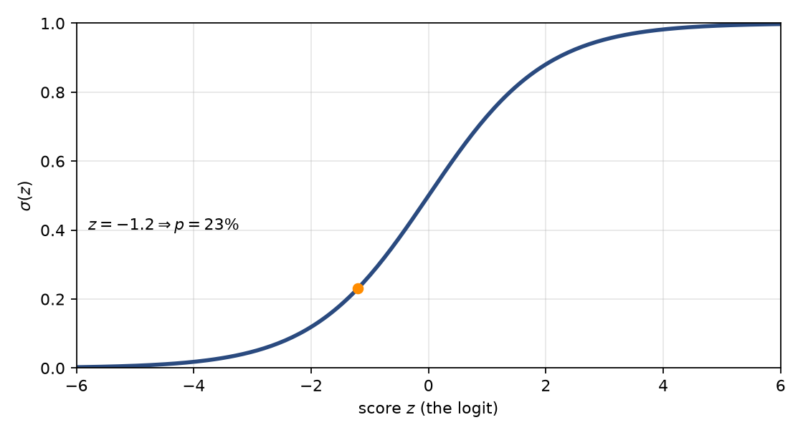
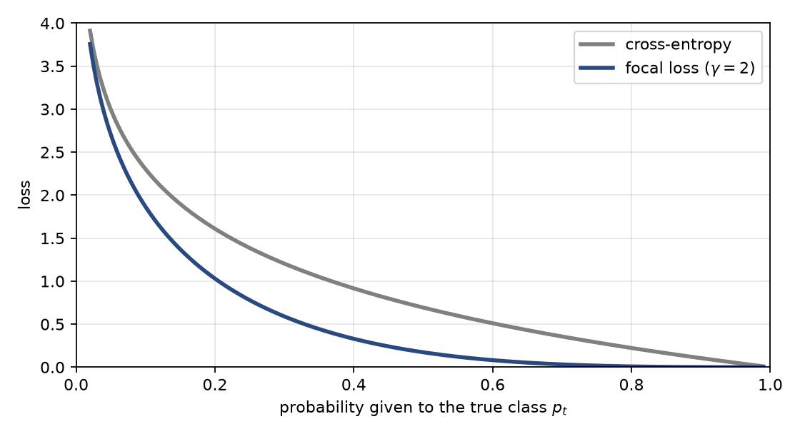
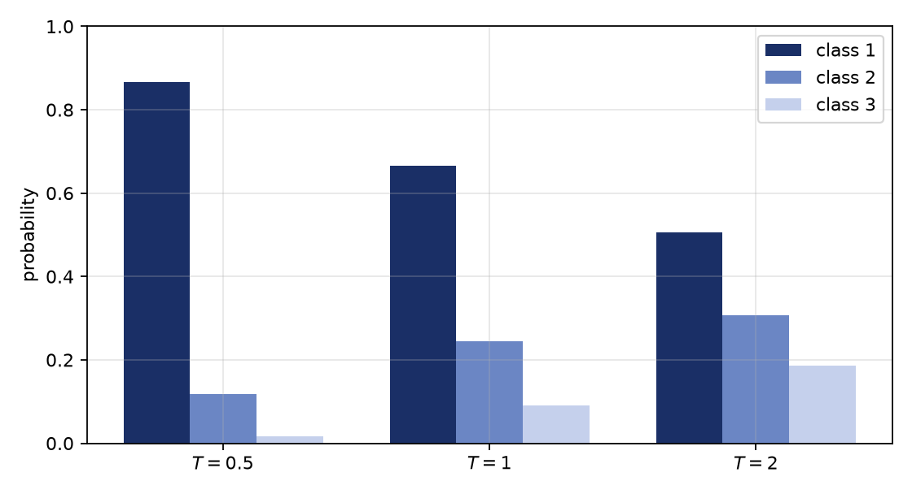

# Binary classification

A binary classifier receives features $x$ and predicts a label $y\in\{0,1\}$. In fraud detection $y=1$ means fraud and $y=0$ means legitimate. The useful output is not a hard label but a probability 

$$p(x) = \mathbb{P}(Y=1\mid x),$$

 because decisions (block, review, allow) depend on a threshold that reflects the cost of each kind of error.

> **Example**
>
> **Example 1** (Running example). A payment network processes $1{,}000{,}000$ transactions, of which $5{,}000$ are fraud. The base rate (prior) is $\pi=\mathbb{P}(Y=1)=0.5\%$. A transaction with the pattern *3 a.m., large amount, new device* occurs in $3{,}000$ of the $5{,}000$ frauds and in about $10{,}000$ of the $995{,}000$ legitimate cases.

Two ways of conditioning give very different answers: 

$$\mathbb{P}(\text{pattern}\mid\text{fraud})=\tfrac{3000}{5000}=60\%,
\qquad
\mathbb{P}(\text{fraud}\mid\text{pattern})=\tfrac{3000}{13000}\approx 23.1\%.$$

 The first describes how fraudsters behave; the second says how trustworthy an alert is. The gap between them is caused by the rarity of fraud, and odds are the cleanest way to see this.

# Odds

> **Metric**
>
> Definition: odds For an event with probability $p$, the *odds* are 

$$\text{odds}(p)=\frac{p}{1-p},\qquad p=\frac{\text{odds}}{1+\text{odds}}.$$

Odds restate a probability as “for versus against”. If $3$ of every $13$ alerts are fraud, then $p=3/13\approx 23\%$ and the odds are $3:10=0.30$.

|  $p$ | odds $p/(1-p)$ | In words                         |
|-----:|---------------:|:---------------------------------|
| 0.5% |        0.00503 | about 1 fraud per 199 legitimate |
|  10% |          0.111 | 1 per 9                          |
|  23% |           0.30 | 3 per 10                         |
|  50% |              1 | even odds                        |
|  90% |              9 | 9 per 1                          |

: Probability versus odds. For small $p$ they are almost equal; they separate as $p$ grows.

## Why odds?

1.  Odds range over $[0,\infty)$ rather than $[0,1]$, which is one step closer to what a linear function can produce.

2.  Evidence multiplies odds. Bayes’ rule in odds form is 

$$\underbrace{\frac{\mathbb{P}(Y=1\mid x)}{\mathbb{P}(Y=0\mid x)}}_{\text{posterior odds}}
    =\underbrace{\frac{\mathbb{P}(Y=1)}{\mathbb{P}(Y=0)}}_{\text{prior odds}}
    \times
    \underbrace{\frac{\mathbb{P}(x\mid Y=1)}{\mathbb{P}(x\mid Y=0)}}_{\text{likelihood ratio}}.$$

 The marginal $\mathbb{P}(x)$ appears in both posteriors and cancels.

> **Example**
>
> **Example 2**. In Example <a href="#ex:run" data-reference-type="ref" data-reference="ex:run">1</a> the prior odds are $5000:995000\approx 0.005$ and the likelihood ratio is $0.60/0.01=60$. Posterior odds $=0.005\times 60=0.30$, i.e. $3000:10000$, a $23\%$ fraud probability. The pattern is $60$ times more common among fraud, yet only $23\%$ of cases showing it are fraud, because the prior odds are about $1:199$.

# The logit (log-odds)

> **Metric**
>
> Definition: logit 

$$\mathop{\mathrm{logit}}(p)=\ln\frac{p}{1-p}.$$

Odds are never negative, but a linear score $w^\top x+b$ can be any real number. The logarithm removes the last restriction: odds $<1$ give a negative logit, odds $=1$ give $0$, odds $>1$ give a positive logit, and $0,\infty$ map to $\mp\infty$. The logarithm also turns the product in Bayes’ rule into a sum: 

$$\mathop{\mathrm{logit}}\mathbb{P}(Y=1\mid x)=\mathop{\mathrm{logit}}\pi+\ln\frac{\mathbb{P}(x\mid Y=1)}{\mathbb{P}(x\mid Y=0)}.$$

 Each piece of evidence adds a number to a running score, which is exactly how a linear model works.

| $p$ |   odds | $\mathop{\mathrm{logit}}(p)$ |
|----:|-------:|-----------------------------:|
|  1% | 0.0101 |                     $-4.595$ |
| 10% |  0.111 |                     $-2.197$ |
| 50% |      1 |                          $0$ |
| 90% |      9 |                     $+2.197$ |
| 99% |     99 |                     $+4.595$ |

: The logit is antisymmetric: $\mathop{\mathrm{logit}}(1-p)=-\mathop{\mathrm{logit}}(p)$.

> **Example**
>
> **Example 3**. The prior logit is $\ln(1/199)=-5.29$. The pattern adds $\ln 60=+4.09$, giving $-1.20$: odds $0.30$, probability $23\%$. The score rose by $4.09$ but stays negative because the prior was so low.

# The sigmoid

> **Metric**
>
> Definition: sigmoid 

$$\sigma(z)=\frac{1}{1+e^{-z}},\qquad \sigma(\mathop{\mathrm{logit}}(p))=p.$$

#### Derivation.

Solve $z=\ln\frac{p}{1-p}$ for $p$: 

$$e^{z}=\frac{p}{1-p}\;\Rightarrow\; e^{z}(1-p)=p\;\Rightarrow\; p=\frac{e^{z}}{1+e^{z}}=\frac{1}{1+e^{-z}}.$$

#### Properties.

$\sigma(z)\in(0,1)$; $\sigma(0)=\tfrac12$; $\sigma(-z)=1-\sigma(z)$; $\sigma'(z)=\sigma(z)(1-\sigma(z))$, with maximum slope $0.25$ at $z=0$; every $+1$ on the score multiplies the odds by $e$.

> **Insight**
>
> Logit and sigmoid are the same relationship seen from two sides. A classifier works in score space, where addition and linear models are natural, and reports in probability space, where decisions and costs live.

# Logistic regression

> **Metric**
>
> Model Logistic regression assumes the log-odds are linear in the features: 

$$\mathop{\mathrm{logit}}\mathbb{P}(Y=1\mid x)=w^\top x+b
> \quad\Longleftrightarrow\quad
> \mathbb{P}(Y=1\mid x)=\sigma(w^\top x+b).$$

#### Reading the weights.

Increasing $x_j$ by one unit raises the score by $w_j$ and multiplies the odds by $e^{w_j}$ (the *odds ratio*). For $w_j=0.7$, $e^{0.7}=2.014$: the odds double. The bias $b$ is the logit at $x=0$ and carries the base rate.

#### Why is the assumption reasonable?

If features within each class are Gaussian with different means and a shared covariance $\Sigma$, then the quadratic terms cancel and 

$$\ln\frac{\mathbb{P}(x\mid1)}{\mathbb{P}(x\mid0)}=(\mu_1-\mu_0)^\top\Sigma^{-1}x+\text{const},$$

 which is linear in $x$; adding the prior logit changes only the bias. The assumption concerns the log-odds, not the data being Gaussian.

#### Geometry.

The boundary at threshold $0.5$ is the hyperplane $w^\top x+b=0$. A different threshold $t$ shifts it parallel to itself to $w^\top x+b=\mathop{\mathrm{logit}}(t)$.

# Binary cross-entropy

For label $y\in\{0,1\}$ and $p=\sigma(z)$, the model gives $\mathbb{P}(y\mid x)=p^{y}(1-p)^{1-y}$. For independent examples, the negative log-likelihood is 

$$\mathcal L=-\frac1N\sum_{i=1}^{N}\bigl[y_i\ln p_i+(1-y_i)\ln(1-p_i)\bigr].$$

 A confident wrong prediction is expensive: $p=0.01$ on a fraud case costs $-\ln 0.01=4.6$.

> **Metric**
>
> Gradient Using $\sigma'=\sigma(1-\sigma)$, 

$$\frac{\partial\mathcal L}{\partial z}=p-y,\qquad
> \frac{\partial\mathcal L}{\partial w}=(p-y)\,x .$$

Consequences:

1.  **No vanishing gradient.** At $p=0.01,\,y=1$ the cross-entropy gradient is $-0.99$, whereas squared error gives about $-0.0098$.

2.  **Balance at the base rate.** If the model outputs $p=\pi=0.5\%$ for everyone, gradients on the $5{,}000$ positives sum to $-4{,}975$ and on the $995{,}000$ negatives to $+4{,}975$. They cancel, so the loss is minimised when predicted probability equals empirical frequency, which is why log loss yields calibrated probabilities.

The loss is convex in $(w,b)$.

#### Focal loss.

Focal loss multiplies each term by $(1-p_t)^{\gamma}$, with $p_t$ the probability given to the true class. For $\gamma=2$ and $p_t=0.9$ cross-entropy is $0.1054$ and focal loss $0.00105$; at $p_t=0.5$ they are $0.693$ and $0.173$. Easy examples are suppressed, at the cost of calibration.

# From two classes to $K$: odds against a reference class

With $K$ classes there is no single “other” class, so choose a reference (say class $K$) and compare every class with it: 

$$\ln\frac{\mathbb{P}(Y=k\mid x)}{\mathbb{P}(Y=K\mid x)}=z_k-z_K,\qquad k=1,\dots,K-1 .$$

 Setting $z_K=0$, the odds of class $k$ against the reference are $e^{z_k}$, and normalisation gives 

$$\mathbb{P}(Y=K\mid x)=\frac{1}{1+\sum_{j<K}e^{z_j}},\qquad \mathbb{P}(Y=k\mid x)=\mathbb{P}(Y=K\mid x)\,e^{z_k}.$$

 This is multinomial logistic regression, with $K-1$ weight vectors. The case $K=2$ is ordinary logistic regression.

> **Example**
>
> **Example 4**. Classes: legitimate (reference), card-not-present fraud, account takeover, with $z_{\text{cnp}}=1$, $z_{\text{ato}}=0$. Then $\mathbb{P}(\text{legit})=1/(1+e+1)=0.212$, $\mathbb{P}(\text{cnp})=0.576$, $\mathbb{P}(\text{ato})=0.212$.

Choosing another reference changes the individual weights but not the probabilities: only score *differences* matter. This leads to the symmetric form.

# Softmax

> **Metric**
>
> Definition: softmax 

$$\mathop{\mathrm{softmax}}(z)_k=\frac{e^{z_k}}{\sum_{j=1}^{K}e^{z_j}}.$$

Dividing numerator and denominator by $e^{z_K}$ recovers the reference-class form. For $K=2$, $\mathop{\mathrm{softmax}}(z)_1=\sigma(z_1-z_2)$: the sigmoid is a two-class softmax.

#### Properties.

Outputs are positive and sum to $1$; adding a constant to all scores changes nothing (subtract $\max_k z_k$ in code to avoid overflow); the log-odds between any two classes is $z_i-z_j$.

#### Temperature.

Replace $z$ by $z/T$. For scores $(2,1,0)$:

| $T$ | class 1 | class 2 | class 3 |
|----:|--------:|--------:|--------:|
| 0.5 |  0.8668 |  0.1173 |  0.0159 |
|   1 |  0.6652 |  0.2447 |  0.0900 |
|   2 |  0.5065 |  0.3072 |  0.1863 |

: As $T\to0$ the output becomes one-hot; as $T\to\infty$ it becomes uniform.

#### Multi-class versus multi-label.

Softmax assumes exactly one correct class. If several labels can hold at once, use an independent sigmoid per label.

# Categorical cross-entropy

With a one-hot label ($1$ at the true class $c$) and softmax probabilities $p$, 

$$\mathcal L=-\sum_{k=1}^{K}y_k\ln p_k=-\ln p_c .$$

 Binary cross-entropy is the case $K=2$. The gradient with respect to the logits is again prediction minus truth: 

$$\frac{\partial\mathcal L}{\partial z_k}=p_k-y_k,$$

 and sums to zero across classes, consistent with shift invariance.

> **Example**
>
> **Example 5**. Scores $(2,1,0)$ give $p=(0.6652,0.2447,0.0900)$. If the true class is $2$: $\mathcal L=-\ln0.2447=1.408$, gradient $(0.6652,-0.7553,0.0900)$. If it is class $1$: $\mathcal L=-\ln0.6652=0.408$.

Squared error again suffers vanishing gradients for confident wrong predictions and is not the maximum-likelihood objective. In practice, frameworks fuse softmax and cross-entropy on raw logits (log-sum-exp trick) for stability.

# Worked examples

> **Example**
>
> **Example 6** (Prior shift). A model trained when fraud was $0.5\%$ is deployed at $0.25\%$, assuming only the prior changed: 

$$z_{\text{new}}=z_{\text{old}}+\mathop{\mathrm{logit}}(\pi_{\text{new}})-\mathop{\mathrm{logit}}(\pi_{\text{old}})=z_{\text{old}}-0.696 .$$

 Odds are multiplied by $0.4987$. A score of $23\%$ (odds $0.30$) becomes odds $0.150$, i.e. $13\%$. This is a bias shift, so ROC-AUC and PR-AUC are unchanged while precision at a fixed threshold changes. The same correction maps probabilities from a resampled training set back to the real base rate.

> **Example**
>
> **Example 7** (Odds ratio). A weight of $0.7$ on “new device” gives odds ratio $e^{0.7}=2.014$. From baseline odds $0.00503$ (0.5%) the new-device odds are $0.01013$, about $1.0\%$. Doubling odds roughly doubles a small probability, but from $50\%$ it only reaches $67\%$.

> **Example**
>
> **Example 8** (Probabilities versus decisions). With $p=(0.665,0.245,0.090)$ for (legitimate, CNP, ATO) the arg-max is legitimate, yet the fraud mass is $33.5\%$. If account takeover is far costlier than a false alert, decide by expected cost, not arg-max.

# Cheat sheet and interview one-liners

| Concept | Formula | Meaning |
|:---|:---|:---|
| Odds | $p/(1-p)$ | for versus against, $[0,\infty)$ |
| Logit | $\ln\frac{p}{1-p}$ | log-odds, whole real line |
| Sigmoid | $1/(1+e^{-z})$ | score $\to$ probability |
| Logistic regression | $\sigma(w^\top x+b)$ | log-odds linear in $x$ |
| Odds ratio | $e^{w_j}$ | odds multiplier per unit |
| BCE | $-[y\ln p+(1-y)\ln(1-p)]$ | negative log-likelihood |
| Gradient | $p-y$ | prediction minus truth |
| Softmax | $e^{z_k}/\sum_j e^{z_j}$ | $K$-class sigmoid |
| Categorical CE | $-\ln p_c$ | NLL of the true class |
| Prior shift | $z+\mathop{\mathrm{logit}}\pi_{\text{new}}-\mathop{\mathrm{logit}}\pi_{\text{old}}$ | bias adjustment |

- **What is the logit?** The log of the odds; it maps $(0,1)$ onto the real line so a linear model can predict it.

- **What does logistic regression assume?** That log-odds are linear in the features, not that the data are Gaussian.

- **Why cross-entropy, not MSE?** It is the maximum-likelihood loss, convex here, and its gradient $p-y$ does not vanish when the sigmoid saturates.

- **How do you read a coefficient?** $e^{w}$ is the odds multiplier per unit, others fixed.

- **Sigmoid versus softmax?** Sigmoid is softmax with two classes applied to the score difference.

- **Why is precision low for a rare class?** Posterior odds $=$ prior odds $\times$ likelihood ratio; prior odds $1:199$ shrink even a likelihood ratio of $60$ to a $23\%$ probability.

- **What changes under prior shift?** The bias, by $\mathop{\mathrm{logit}}\pi_{\text{new}}-\mathop{\mathrm{logit}}\pi_{\text{old}}$; ranking is unchanged, thresholds must be re-set.

- **Why can focal loss hurt calibration?** It down-weights confident examples, so the minimiser is no longer the true probability; recalibrate (Platt or isotonic) before using scores as probabilities.
