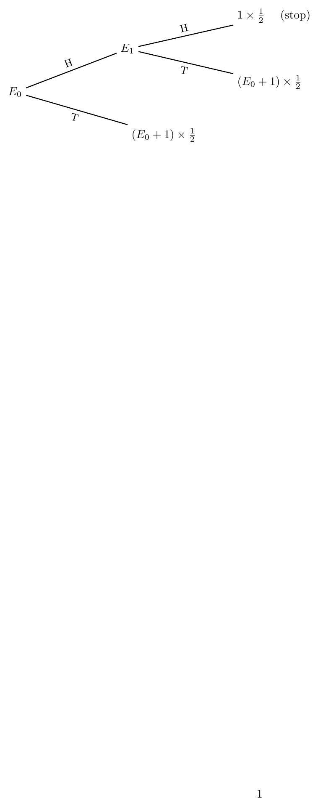
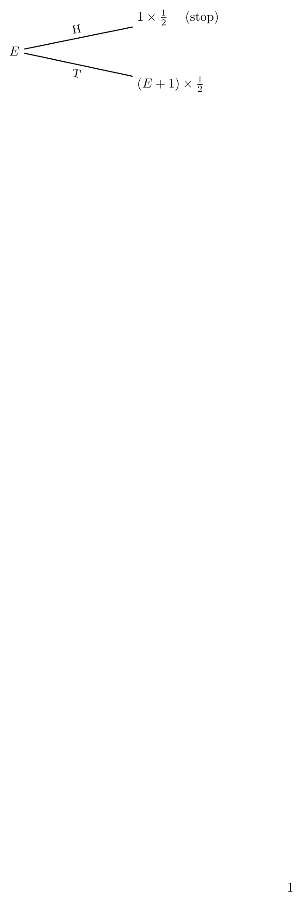
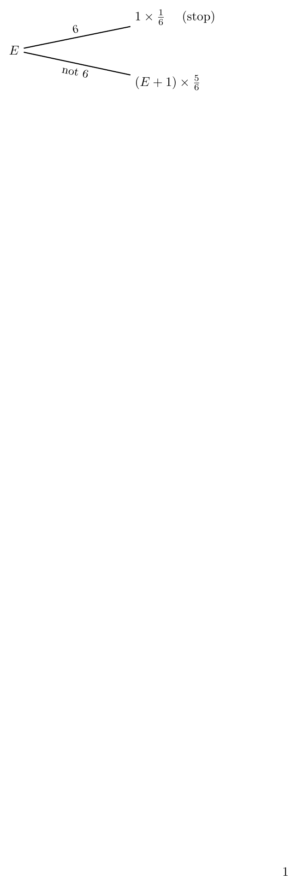
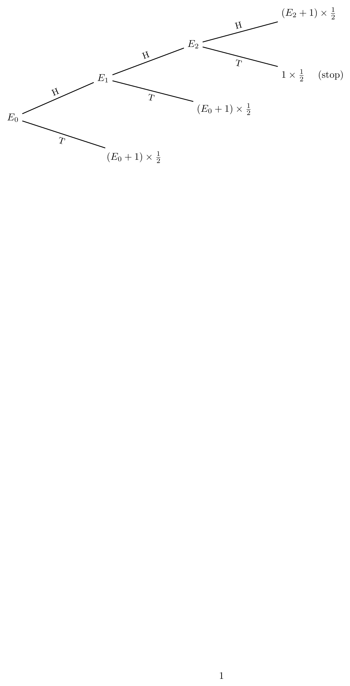
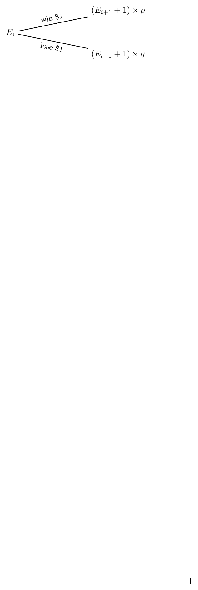

# First-Step Analysis: Interview Questions and Answers

## How to read the trees

$E_s$ is the expected number of *additional* tosses from state $s$. Each branch is one toss. A leaf shows 

$$(\text{new state's expectation} + 1)\times(\text{probability of that branch}),$$

 where the $+1$ pays for the toss just made. A leaf that stops the game shows $1\times$ probability. Adding the leaves gives the equation for the state.

## Question 0: Expected Tosses Until HH

**Question:** A fair coin is tossed until two Heads appear in a row (HH). What is the expected number of tosses?

**Answer:**

Reading the leaves of the tree:

$$E_1=\tfrac12(1)+\tfrac12(E_0+1)=1+\tfrac12E_0 \quad\text{(1)}$$

 

$$E_0=\tfrac12(E_1+1)+\tfrac12(E_0+1)=\tfrac12E_1+\tfrac12E_0+1 \quad\text{(2)}$$

Put (1) into (2):

$$E_0=\tfrac12\Bigl(1+\tfrac12E_0\Bigr)+\tfrac12E_0+1
=\tfrac32+\tfrac34E_0
\quad\Longrightarrow\quad
\tfrac14E_0=\tfrac32$$

$$\boxed{E_0=6}.$$

## Question 1: Expected Tosses Until the First Head

**Question:** A fair coin is tossed repeatedly until the first Head appears. What is the expected number of tosses?

**Answer:**

$$E=\frac12(1)+\frac12(E+1)$$

$$E=1+\frac12E
\quad\Longrightarrow\quad
\frac12E=1$$

$$\boxed{E=2}.$$

## Question 2: Expected Rolls Until the First 6

**Question:** A fair six-sided die is rolled until the first 6 appears. What is the expected number of rolls?

**Answer:**

$$E=\frac16(1)+\frac56(E+1)$$

$$E=1+\frac56E
\quad\Longrightarrow\quad
\frac16E=1$$

$$\boxed{E=6}.$$

## Question 3: Expected Tosses Until HHT Appears

**Question:** A fair coin is tossed until the pattern HHT first appears. Find the expected number of tosses.

States: $E_0$ = nothing matched, $E_1$ = last toss H, $E_2$ = last two tosses HH.

Note that from $E_2$ another H leaves you in $E_2$, since the last two tosses are still HH.

**Answer:**

Reading the leaves:

$$E_2=\tfrac12(1)+\tfrac12(E_2+1)\quad\Rightarrow\quad E_2=2,$$

$$E_1=\tfrac12(E_2+1)+\tfrac12(E_0+1)=2+\tfrac12E_0,$$

$$E_0=\tfrac12(E_1+1)+\tfrac12(E_0+1)\quad\Rightarrow\quad E_0=E_1+2.$$

Substituting $E_1$ gives $E_0=4+\tfrac12E_0$, so

$$\boxed{E_0=8}.$$

## Question 4: Random Walk Intuition

**Question:** What is the main idea behind first-step analysis in random-walk problems?

**Answer:**

A random walk moves between states. The key observation is:

> After taking the next step, the process is again in a state whose future behavior can be described by the same expectation equations.

The general form, with $E=0$ at every stopping state, is:

$$E(\text{current state}) = \sum P(\text{next state})\bigl[E(\text{next state})+1\bigr].$$

## Question 5: Gambler’s Ruin Intuition

**Question:** How does first-step analysis help in Gambler’s Ruin problems?

**Answer:**

Suppose a gambler currently has $i$ dollars. If $E_i$ denotes the expected time until ruin or victory from state $i$, then reading the leaves,

$$E_i=p\,(E_{i+1}+1)+q\,(E_{i-1}+1)=1+pE_{i+1}+qE_{i-1},
\qquad E_0=E_N=0.$$

## Key Takeaway

$$\boxed{
E(\text{state})
=
\sum P(\text{branch})\bigl[E(\text{new state})+1\bigr]
}$$

Draw the tree, write each leaf as (new expectation $+1$) $\times$ probability, and add the leaves.
